<p align="center">
  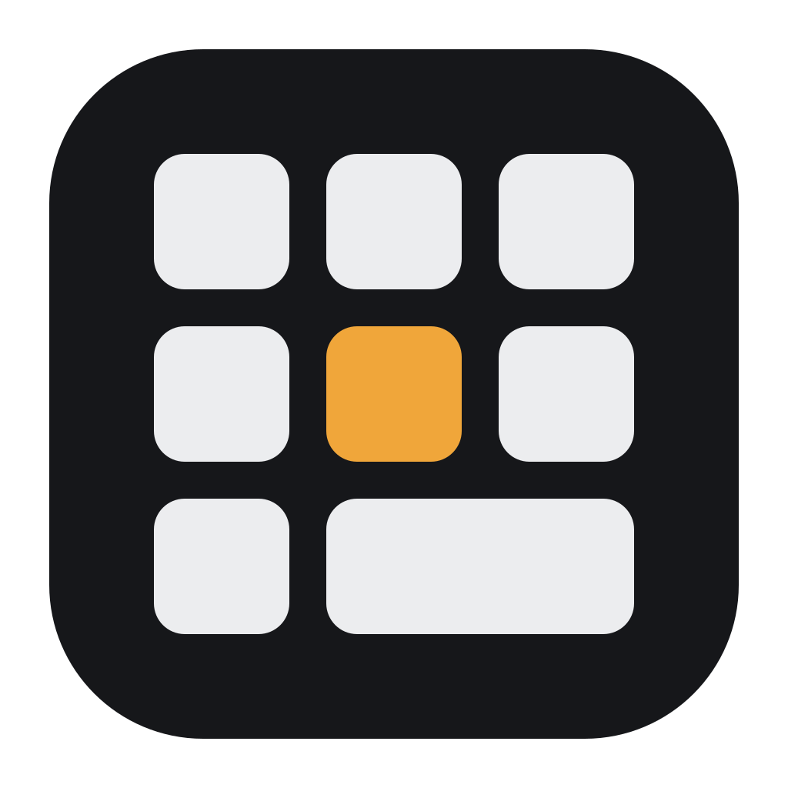
</p>

<h1 align="center">D200 Deck</h1>

<p align="center">
  Teclas que mudam sozinhas no <strong>Ulanzi D200</strong>, conforme o app ou o site que você está usando.<br>
  Um substituto do Ulanzi Studio para Windows.
</p>

<p align="center">
  <a href="https://github.com/argus-cs/d200-deck/releases/latest"><strong>Baixar o instalador</strong></a>
  ·
  <a href="#o-que-faz">O que faz</a>
  ·
  <a href="#instalar">Instalar</a>
  ·
  <a href="CHANGELOG.md">Novidades</a>
</p>

<picture>
  <source media="(prefers-color-scheme: dark)" srcset="docs/images/live-dark.png">
  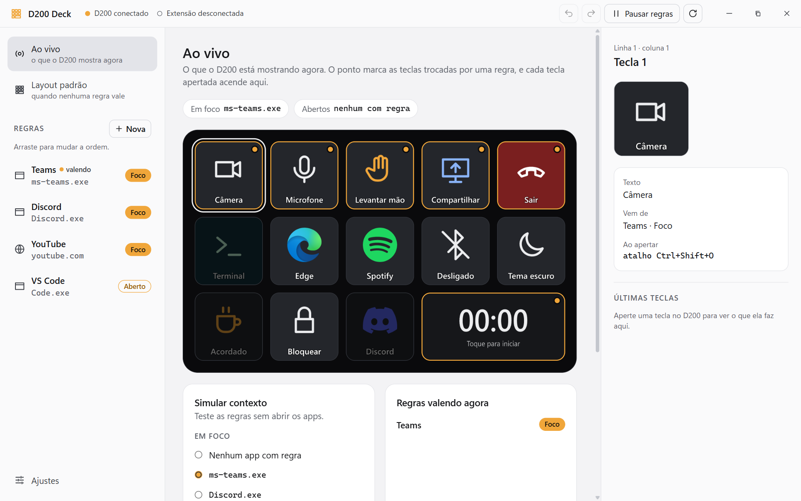
</picture>

## O que faz

### Teclas que acompanham o que você está fazendo

Uma **regra** liga um app ou um site do Edge a algumas teclas. Ela troca só as teclas que você escolheu; as outras continuam com o layout padrão, e tudo volta ao normal quando a regra deixa de valer. Cada regra funciona num de dois modos:

- **Foco:** vale só com o app ou a aba do site na frente.
- **Aberto:** vale enquanto o app ou o site estiver aberto, mesmo minimizado.

Abaixo, o mesmo D200 no layout padrão, numa reunião do Teams, no YouTube, numa call do Discord e com o VS Code aberto. O ponto no canto marca as teclas trocadas por uma regra, e o visor também pode mudar com ela.

<picture>
  <source media="(prefers-color-scheme: dark)" srcset="docs/images/rules-dark.gif">
  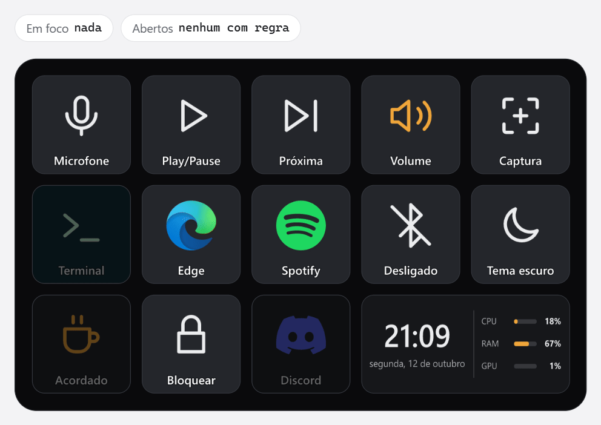
</picture>

Teclas de uma regra podem trazer o app para a frente, mandar o atalho e devolver o foco para onde você estava: dá para mutar o Teams sem sair do editor de código. O simulador da janela "Ao vivo" testa as regras sem abrir os apps.

### Um editor para cada camada

O layout padrão e cada regra têm o seu editor. Numa regra, as teclas que vêm do padrão aparecem tracejadas, e as trocadas, com borda âmbar. Arraste uma tecla sobre outra para trocar as duas de lugar, copie e cole com Ctrl+C e Ctrl+V, e desfaça com Ctrl+Z. Tudo é salvo sozinho.

<picture>
  <source media="(prefers-color-scheme: dark)" srcset="docs/images/rule-dark.png">
  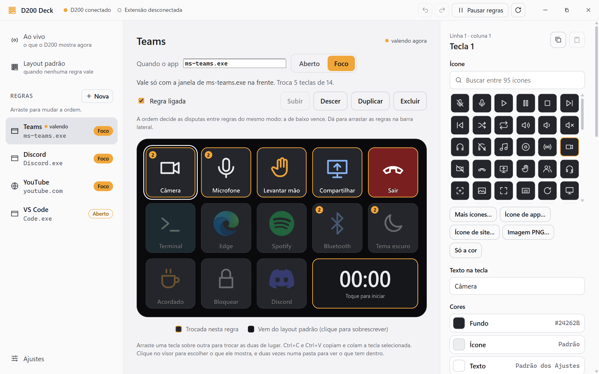
</picture>

### Teclas do seu jeito

- **Ícone:** 95 embutidos, mais de 370 mil do [Iconify](https://iconify.design) (a mesma fonte do [Icônes](https://icones.js.org)), o ícone do app, o favicon do site ou um PNG seu.
- **Cores** de fundo, ícone, texto e borda, em cada tecla.
- **Ações:** atalho de teclado, abrir app, arquivo, pasta ou site, rodar comando, digitar texto e mídia (play/pause, faixa, volume).
- **Dois estados:** cada toque alterna entre duas aparências, como câmera ligada e desligada.
- Teclas que **abrem um app** ficam escurecidas enquanto ele está fechado.

As coleções do Iconify são baixadas só quando você as abre, e o ícone escolhido fica salvo no PC: o D200 não precisa de internet.

<picture>
  <source media="(prefers-color-scheme: dark)" srcset="docs/images/icons-dark.png">
  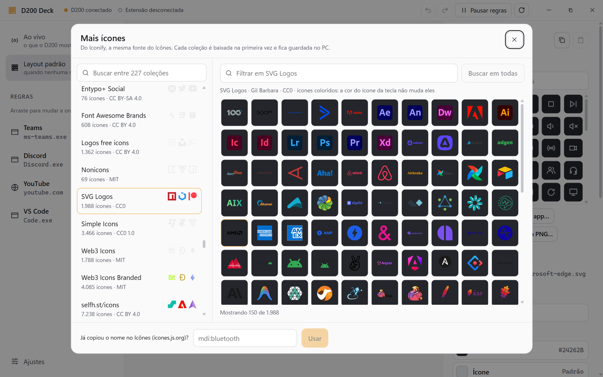
</picture>

### Ajustes do Windows, com o estado real

A tecla mostra o estado de verdade do Windows, e muda mesmo se você mexer pelo próprio Windows.

- **Ligar e desligar:** Bluetooth, Wi-Fi, microfone e som mudos no sistema todo, tema escuro e manter o PC acordado.
- **Escolher:** a saída de áudio (fone ou caixa), a entrada de áudio (o microfone), o modo de projeção (como o Win+P) e o modo de energia.
- **Fazer uma vez:** suspender, desligar o PC, desligar a tela e esvaziar a lixeira.

<picture>
  <source media="(prefers-color-scheme: dark)" srcset="docs/images/windows-dark.png">
  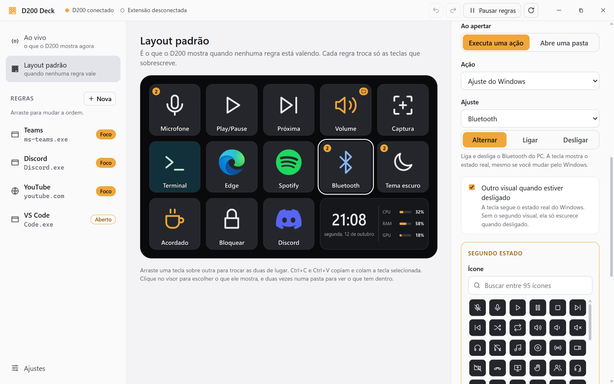
</picture>

### Pastas

Uma tecla abre um grupo de até 12 teclas no lugar do layout. Usar uma delas volta ao normal, e a tecla 1 volta sem fazer nada. A pasta também pode ficar aberta enquanto você usa, como num controle de volume.

<picture>
  <source media="(prefers-color-scheme: dark)" srcset="docs/images/folder-dark.png">
  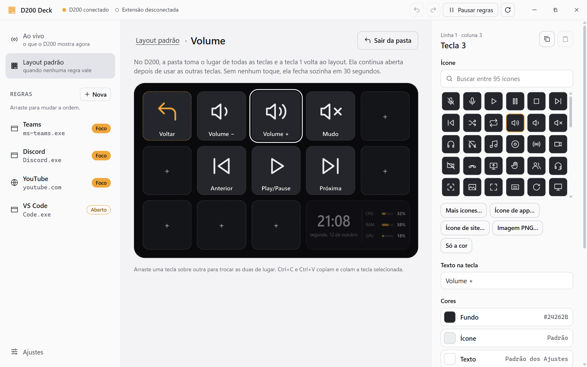
</picture>

### Visor

O visor largo (a tecla 14) mostra relógio, uso do PC (CPU, memória, GPU e rede), a música tocando agora com a capa, cronômetro ou Pomodoro, texto ou imagem. Cada regra pode ter o seu. Tocar executa uma ação, e segurar executa outra, alterna o que o visor mostra ou traz o layout padrão de volta às teclas até você usar uma delas (com o Spotify na frente, segure o visor, use uma tecla do padrão e as teclas do Spotify voltam).

<table>
  <tr>
    <td>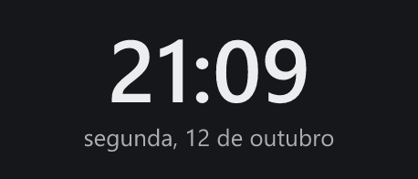</td>
    <td>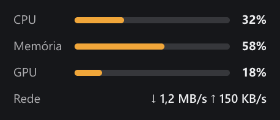</td>
  </tr>
  <tr>
    <td>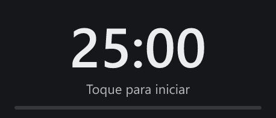</td>
    <td>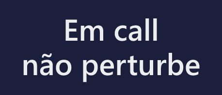</td>
  </tr>
</table>

<picture>
  <source media="(prefers-color-scheme: dark)" srcset="docs/images/visor-dark.png">
  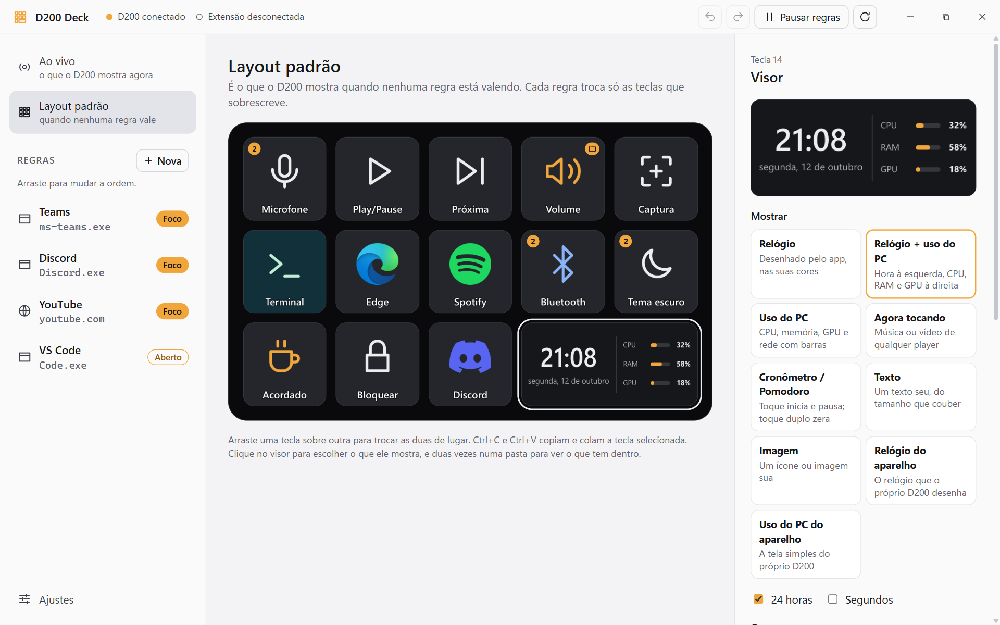
</picture>

### E mais

- O D200 ao vivo na janela, com cada tecla apertada acendendo.
- Tema claro ou escuro, acompanhando o Windows.
- O app fica na bandeja e pode iniciar com o Windows.
- **Atualizações:** o app avisa quando sai uma versão nova e se atualiza quando você manda (no aviso da janela, nos Ajustes ou na bandeja).

## Instalar

1. Baixe o `D200.Deck_X.Y.Z_x64-setup.exe` do [último release](https://github.com/argus-cs/d200-deck/releases/latest) e rode. Ele não pede administrador. Se o Windows avisar que o instalador não é reconhecido (ele não tem assinatura digital), clique em **Mais informações** → **Executar assim mesmo**.
2. **Feche o Ulanzi Studio** (`UlanziDeck.exe`) e tire-o da inicialização do Windows: os dois disputam o aparelho.
3. Para regras de site, carregue a [extensão do Edge](#extensão-do-edge-regras-de-site).

Requisitos: Windows 10 ou 11 e um Ulanzi D200 (USB `VID 2207`, `PID 0019`). Microsoft Edge, se for usar regras de site.

Fechar a janela deixa o app rodando na bandeja; para encerrar, use **Sair** no menu da bandeja.

## Extensão do Edge (regras de site)

1. Abra `edge://extensions` e ligue o **Modo de desenvolvedor**.
2. Clique em **Carregar sem pacote** e escolha a pasta `extension-edge`. No app instalado, ela fica na pasta de instalação, e o guia dentro do app abre essa pasta e a página de extensões.
3. Depois de mudar algo na extensão, clique em recarregar nela.

A extensão só conversa com o próprio computador (`127.0.0.1:47820`), e o app recusa qualquer conexão que não venha dela: páginas da web e outras extensões ficam de fora. Abas InPrivate não são vistas.

Na versão 0.3.3 a extensão ganhou um ID fixo. Quem já tinha a extensão carregada precisa recarregá-la uma vez em `edge://extensions` depois de atualizar o app. Se ela continuar desconectada, remova e carregue de novo.

## Configuração

Tudo é salvo em `%APPDATA%\D200Deck\config.json`, e os ícones escolhidos são copiados para `%APPDATA%\D200Deck\icons`. O arquivo pode ser editado à mão: o app percebe a mudança e recarrega. Uma configuração inválida é ignorada, e o app continua com a anterior.

O que o app faz e os erros que encontra ficam em `%APPDATA%\D200Deck\d200deck.log`, que é o primeiro lugar para olhar quando algo não funciona.

## Limitações conhecidas

- Atalhos simulados não chegam a apps rodando como administrador.
- Apps UWP (Calculadora, Configurações) aparecem como `ApplicationFrameHost.exe` na janela da frente.
- Combinações com a tecla Win não podem ser gravadas: digite-as no campo, por exemplo `Win+G`.
- Uma atualização de firmware pelo Ulanzi Studio pode mudar o protocolo.
- Trocar a saída ou a entrada de áudio e o modo de energia usa APIs não documentadas do Windows, que uma atualização pode mudar. O modo de energia só tem efeito com o plano Equilibrado.
- Escolher ícones do Iconify precisa de internet na primeira vez de cada coleção. Algumas coleções (licença CC BY) pedem crédito ao autor; a janela mostra a licença de cada uma.

## Desenvolvimento

### Compilar

Precisa de [Rust](https://rustup.rs) estável e Node.js 20.19 ou mais novo.

```
cd app
npm install
npx tauri dev                          # desenvolvimento, com recarga da interface
npx tauri build                        # instalador em target/release/bundle/nsis
npx tauri build --debug --no-bundle    # só o executável, em target/debug/d200-deck.exe
```

O executável não pode ser substituído com o app aberto.

O `tauri build` assina o instalador para as atualizações e precisa da chave privada nas variáveis `TAURI_SIGNING_PRIVATE_KEY` e `TAURI_SIGNING_PRIVATE_KEY_PASSWORD`. Sem ela, use `npx tauri build --debug --no-bundle`.

### Testes e ferramentas

```
cargo test -p d200 -p deck-engine
cd app && npm run check                                  # tipos da interface
cargo run -p d200 --bin probe -- list                    # o aparelho é encontrado?
cargo run -p deck-engine --bin try-screen -- <pasta>     # desenha exemplos de visor e teclas em PNG
cargo run -p deck-engine --bin try-open -- <alvo>        # testa a ação "abrir" isolada
cargo run -p deck-engine --bin try-system -- state       # lê os ajustes do Windows (set <ajuste> muda de verdade)
cargo run -p deck-engine --bin try-iconify -- <pasta> sets   # baixa e testa ícones do Iconify numa pasta qualquer
```

O app e o `deckd` não podem rodar juntos, porque os dois usam o aparelho e a porta 47820.

Todo PR para a `main` roda esses testes no GitHub Actions, e o merge só é liberado se eles passarem. A `main` não aceita push direto.

### Imagens deste README

As imagens em `docs/images` saem do app de verdade, com a config de demonstração de [`docs/screenshots/demo-config.json`](docs/screenshots/demo-config.json). Para refazê-las depois de mudar a interface, feche o D200 Deck e rode, na raiz do repositório:

```
node docs/screenshots/capture.mjs
```

O script abre o app em modo de desenvolvimento com um `%APPDATA%` temporário (a sua config não é tocada), usa o simulador de contexto para as regras e captura a janela nos temas claro e escuro. Precisa do `ffmpeg` no PATH para o GIF. Enquanto ele roda, o D200 mostra o layout de demonstração.

### Estrutura

| Pasta | O quê |
| --- | --- |
| `crates/d200` | Driver do protocolo USB do D200 e a ferramenta `probe` |
| `crates/engine` | Motor: regras, ações, desenho das teclas e do visor, laço com o aparelho, `deckd` (o app sem interface) |
| `app` | App Tauri 2: Rust em `src-tauri`, interface em Svelte 5 + TypeScript em `src` |
| `extension-edge` | Extensão Manifest V3 que conta ao app quais sites estão abertos |
| `docs` | Imagens deste README e o script que as refaz |

O protocolo do aparelho, as decisões do projeto e as armadilhas encontradas estão em [`CLAUDE.md`](CLAUDE.md).

### Publicar uma versão

1. Num PR, suba a versão em `Cargo.toml`, `app/src-tauri/tauri.conf.json` e `app/package.json` (`npm version X.Y.Z --no-git-tag-version` na pasta `app`) e escreva a seção da versão no [`CHANGELOG.md`](CHANGELOG.md). Sem ela, o "Testes" do PR falha.
2. Depois do merge, crie a tag na `main`: `git tag vX.Y.Z` e `git push origin vX.Y.Z`.
3. O GitHub Actions gera o instalador e cria o release como rascunho, já com as notas do `CHANGELOG.md`. Publique: os apps instalados passam a oferecer a atualização.

## Referências

O protocolo foi aprendido com [redphx/strmdck](https://github.com/redphx/strmdck) (MIT) e com o rs-ulanzi-d-200-linux (GitLab), e validado no aparelho.
